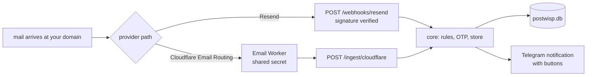
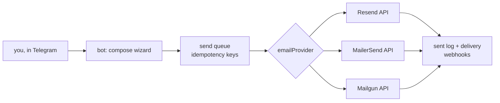
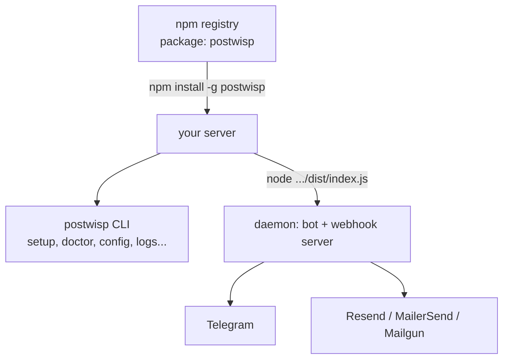
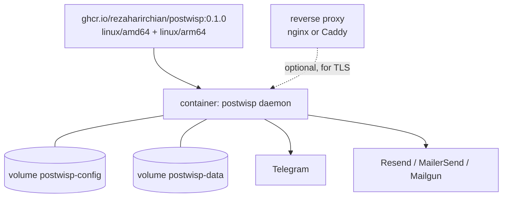
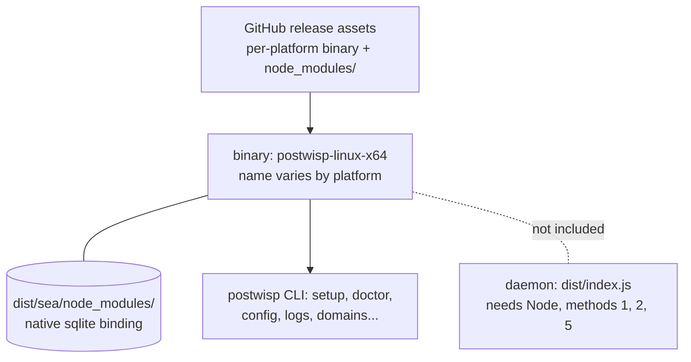
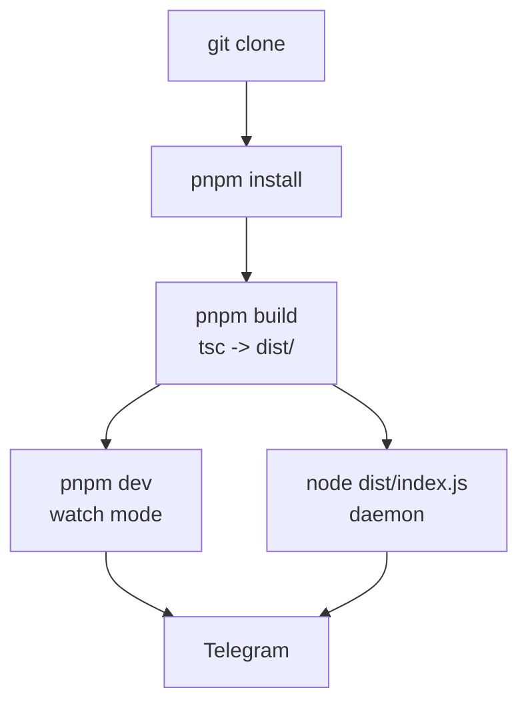
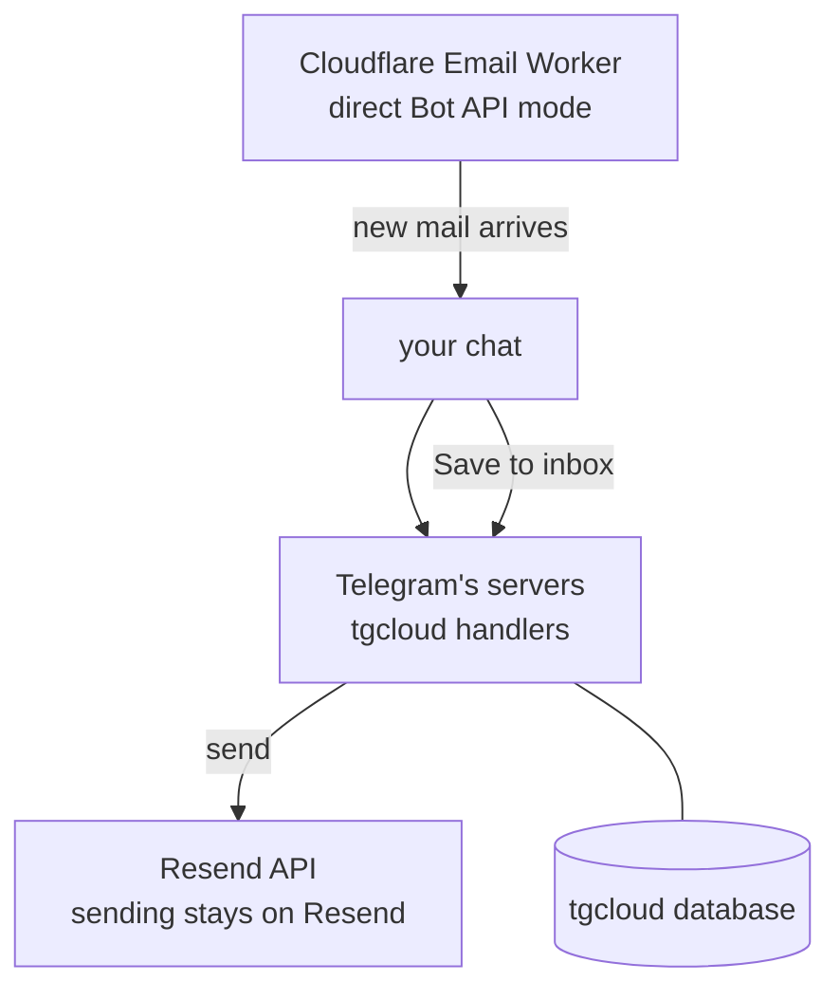

# postwisp

postwisp is a self-hosted Telegram bot for two-way email management. It runs
on your own server, stores mail in a local SQLite database, and talks to you
through Telegram buttons · no dashboard, no hosted service in the middle, no
vendor account beyond the email provider you choose. Inbound mail from your
domains arrives via Resend webhooks or a Cloudflare Email Worker; you read,
reply, compose, schedule, and file drafts from the chat.

Status: v0.1.0, early development. The bot works end to end, but interfaces
and behavior are still settling · do not rely on it as your only mail client
yet.

License: AGPL-3.0-or-later. Copyright (C) 2026 Reza Harirchian.

## What it does

Everything happens in the bot's button UI. There are no commands to memorize
inside Telegram; every screen is a set of inline buttons. A bare `postwisp`
on the command line opens a guided menu that maps to the same commands.

- **Per-domain inbox.** Register your sending domains; inbound mail is
  organized by domain automatically, and the inbox has a domain filter.
- **Read and reply.** Open a message, read the full text, reply · the reply
  goes out through your email provider with proper threading.
- **Compose.** A step-by-step wizard (to, subject, body, confirm) for new
  mail, all from the chat.
- **OTP extraction.** One-time codes in inbound mail are pulled out and shown
  as one-tap copyable values in the Telegram notification.
- **Scheduled send.** Compose now, send later. Pending sends are listed and
  cancellable from the chat.
- **Drafts.** Save a half-written message, reopen it, edit it, send it.
- **Rules.** Simple from/subject matching: archive, mark read, or suppress
  when mail arrives.
- **Suppression and blocklist.** Addresses you should never mail again, and
  senders you never want to hear from again.
- **Quiet hours and digests.** Notifications batch up outside the hours you
  choose.
- **One-click unsubscribe.** Outbound mail carries signed unsubscribe links
  (your own URL, your own footer with your physical address).
- **Stats and search.** Sent counts, delivery events, and search across
  stored mail.

## Architecture

One process runs two halves that share the same core and the same database:

```
                              +----------------+
                              |    Telegram    |
                              |  (button UI,   |
                              |   owner only)  |
                              +---+--------^---+
                                  | updates| messages
                                  v        |
                    +-----------------------------+
                    |   postwisp daemon           |
                    |   (one Node.js process)     |
                    |                             |
                    |  +-----------------------+  |
                    |  | Telegram bot (grammY) |  |
                    |  | menu, compose, inbox, |  |
                    |  | drafts, scheduled     |  |
                    |  +-----------+-----------+  |
                    |              |              |
                    |  +-----------------------+  |
                    |  | core: store, rules,   |  |
                    |  | queue, digest, OTP    |  |
                    |  +-----------+-----------+  |
                    |              |              |
                    |  +-----------------------+  |
                    |  | Fastify HTTP server   |  |
                    |  | port 3000 (default)   |  |
                    |  | POST /webhooks/*      |  |
                    |  | POST /ingest/cloudflare|
                    |  | GET  /healthz         |  |
                    |  | /unsub/:token         |  |
                    |  +-----------+-----------+  |
                    +--------------+-+------------+
                                   | |
         +-------------------------+ +---------------------+
         |                           |                     |
         v                           v                     v
 +----------------+      +-------------------+  +-----------------+
 | Resend         |      | Cloudflare Email  |  | SQLite          |
 | inbound via    |      | Routing worker    |  | postwisp.db     |
 | webhook (POST  |      | POSTs parsed mail |  | mail, drafts,   |
 | /webhooks/     |      | to /ingest/       |  | scheduled,      |
 | resend,        |      | cloudflare with a |  | rules,          |
 | signature-     |      | shared secret     |  | suppression,    |
 | verified)      |      +-------------------+  | sent log        |
 | outbound via   |                             +-----------------+
 | send API       |
 | (MailerSend /  |
 |  Mailgun are   |
 |  the alterna-  |
 |  tives)        |
 +----------------+
```

Mail flow, inbound:



Mail flow, outbound:



## Choosing an install method

| Method | You need | When to pick it |
|---|---|---|
| [npm](#method-1-npm) | Node 20+ | You already run Node and want the plainest install. |
| [Docker](#method-2-docker) | Docker | You want the daemon isolated with its config and data on volumes. |
| [install.sh](#method-4-installsh) | curl, root or sudo | Fresh VPS with nothing on it; the script installs Node for you. |
| [From source](#method-5-from-source) | Node 20+, pnpm | You want to hack on it or run a checkout. |
| [Single-file binary](#method-3-single-file-binary) | The release asset | You want one file with no npm registry dependency. CLI only · see below. |
| [Telegram Serverless](#method-6-telegram-serverless-tgcloud) | Nothing (no server) | You want zero infrastructure and only the core loop. |

All methods end at the same place: run `postwisp setup`, then start the
daemon (methods 1, 4, 5) or the container (method 2).

## Installation

### Method 1: npm



Prerequisites: Node.js 20 or newer (`node --version`).

```sh
npm install -g postwisp
postwisp --version        # should print 0.1.0
```

The CLI is `postwisp`; the daemon is the same package's entry point:

```sh
node "$(npm root -g)/postwisp/dist/index.js"
```

`postwisp doctor` reads its own config and tells you what is missing before
you start.

Success looks like: `postwisp --version` prints a version, `postwisp status`
reports on the install, and `curl http://127.0.0.1:3000/healthz` returns 200
once the daemon is up.

Pick this when you already run Node and want the plainest install, with
updates via `postwisp update` (it checks the npm registry and installs the
newer release).

### Method 2: Docker



Prerequisites: Docker. The published image covers `linux/amd64` and
`linux/arm64`, so Docker pulls the right variant for your machine
automatically.

The image runs the daemon as a non-root user. All secrets and settings
arrive through environment variables or a mounted config file; nothing is
baked into the image. Full detail: `docs/DOCKER.md`.

```sh
# 1. Write the env file (chmod 600): one KEY=value per line
cat > /srv/postwisp/postwisp.env <<'EOF'
POSTWISP_BOT_TOKEN=<token from @BotFather>
POSTWISP_OWNER_ID=<your numeric Telegram user id>
POSTWISP_EMAIL_PROVIDER=resend
POSTWISP_RESEND_API_KEY=<resend api key>
POSTWISP_WEBHOOK_SECRET=<provider-issued webhook secret>
EOF
chmod 600 /srv/postwisp/postwisp.env

# 2. Run the daemon
docker run -d --name postwisp \
  --restart unless-stopped \
  -p 3000:3000 \
  --env-file /srv/postwisp/postwisp.env \
  -v postwisp-config:/home/postwisp/.config/postwisp \
  -v postwisp-data:/home/postwisp/.local/share/postwisp \
  ghcr.io/rezaharirchian/postwisp:0.1.0
```

Inside the container the server binds `0.0.0.0:3000` (so the published port
is reachable); on a bare install it binds `127.0.0.1:3000` by default. Never
put secrets on the command line · they end up in shell history and
`docker ps` output.

To run the interactive wizard once before starting the daemon:

```sh
docker run --rm -it --env-file /srv/postwisp/postwisp.env \
  -v postwisp-config:/home/postwisp/.config/postwisp \
  -v postwisp-data:/home/postwisp/.local/share/postwisp \
  --entrypoint node ghcr.io/rezaharirchian/postwisp:0.1.0 dist/cli/index.js setup
```

The two named volumes keep state across container replacement: `config`
holds the wizard's `config.json`, `data` holds the SQLite database and
attachments. Updating is a stop/replace with the same `-v` flags:

```sh
docker pull ghcr.io/rezaharirchian/postwisp:<new-version>
docker stop postwisp && docker rm postwisp
# re-run the docker run from step 2 with the new tag
```

Success looks like: `curl http://localhost:3000/healthz` returns 200 and
`docker ps` shows the container healthy (there is a built-in HEALTHCHECK on
`/healthz`, 30s interval).

Pick this when you want the daemon isolated, with config and data surviving
container replacement, and no Node on the host.

### Method 3: single-file binary



Prerequisites: a machine matching the build platform (Linux x64, Linux
arm64, or macOS arm64). The binary is a Node runtime with the CLI baked in;
it is platform-specific, so build it on the machine you will run it on.

```sh
git clone https://github.com/RezaHarirchian/postwisp.git
cd postwisp
./scripts/build-sea.sh
# output: dist/sea/postwisp-linux-x64 (name varies by platform)
./dist/sea/postwisp-linux-x64 --version
```

Two things ship together and must stay together: the binary and
`dist/sea/node_modules/` (the native better-sqlite3 binding, which cannot
be embedded in a Node SEA blob; the binary loads it from its own directory
at startup).

Honest limitation, stated plainly: the SEA bundle contains the **CLI only**
(setup, doctor, config, logs, domains, webhooks, pair). The daemon · the
webhook server plus the always-on bot · is `dist/index.js` and is not in
the bundle. Use the binary to manage a postwisp install from a machine
without npm; run the daemon itself with Node (methods 1, 2, or 5).

Pick this when you want one self-contained CLI file with no npm registry
dependency, and you will run the daemon separately.

### Method 4: install.sh

```mermaid
flowchart TB
    S[curl .../install.sh | sh] --> N{node >= 20 present?}
    N -->|no| PM[apt / dnf / pacman / apk\nvia NodeSource where needed]
    PM --> T{still no node?}
    T -->|yes| TB[nodejs.org tarball\nSHA-256 verified]
    N -->|yes| NP[npm install -g postwisp]
    TB --> NP
    NP --> CLI[postwisp ready]
```

Prerequisites: curl, and root or sudo (the script installs system packages).

```sh
curl -fsSL https://raw.githubusercontent.com/RezaHarirchian/postwisp/main/install.sh | sh
```

What the script does, in order: checks for Node 20+ and skips if present;
otherwise installs Node through the native package manager (NodeSource on
apt/dnf families, since distro repos lag), falling back to the official
nodejs.org tarball with its SHA-256 checksum verified against the published
checksum file; then `npm install -g postwisp` and verifies `postwisp
--version`. It is POSIX sh, idempotent, safe to re-run, and never asks for
or prints any secret · credentials come later, through `postwisp setup`.

The pinned Node fallback version is 22.21.0 (pinned so two runs produce the
same runtime).

Success looks like:

```sh
postwisp --version   # prints 0.1.0
postwisp setup      # guided wizard
postwisp doctor     # verifies everything is wired up
```

Pick this on a fresh VPS with nothing on it: one command, then the wizard.

### Method 5: from source



Prerequisites: Node 20+ and pnpm.

```sh
git clone https://github.com/RezaHarirchian/postwisp.git
cd postwisp
pnpm install
pnpm typecheck
pnpm test
pnpm build
pnpm dev        # daemon + bot in watch mode (tsx watch src/index.ts)
```

Or run the built daemon directly: `node dist/index.js`.

Pick this when you want to read the code, run the tests, or change
something. See [Development](#development).

### Method 6: Telegram Serverless (tgcloud)



Prerequisites: a Telegram bot with **Serverless** enabled (from
[@BotFather](https://t.me/BotFather), copy the CLI access token), the
`tgcloud` CLI (`npm install -g @tgcloud/cli`), a Resend API key with a
verified sending domain, and a Cloudflare account with your receiving
domain on it. Full guide: `docs/SERVERLESS.md`.

```sh
tgcloud login            # paste the CLI access token from BotFather
tgcloud push             # upload tgcloud/handlers/ and tgcloud/lib/
tgcloud migrate          # create the kv, emails, outbox, suppression, rules tables
```

Then seed the three secrets the bot needs (`owner_id`, `resend_api_key`,
`from_addr`) with a temporary handler, delete the handler, and push again.
`postwisp deploy:serverless` walks you through all of this: it checks the
prerequisites and prints the ordered steps. It never deploys anything by
itself · the BotFather token and the login are yours to handle.

Honest limitation, stated plainly: Telegram Serverless exposes **no public
HTTPS endpoint**, so nothing can POST webhooks to it. Resend inbound works
through webhooks, which means **Resend inbound does not work with the
serverless build**. Inbound mail takes the Cloudflare direct path instead:
the companion Email Worker (`adapters/cloudflare/worker.js`) sends each
incoming email straight to your Telegram chat with Save / View code / Reply
buttons. The serverless build also has no drafts, scheduled sends,
attachments, multi-provider support (Resend only), or local SQLite · it is
the core loop (read, reply, compose, send), nothing more. If you need the
rest, run the self-hosted bot.

Pick this when you want zero infrastructure and the core loop is enough.

## First run: the setup wizard

However you installed, the next step is the same:

```sh
postwisp setup
```

Seven steps, each verified before the wizard moves on. Resumable: stop
halfway and `postwisp setup` continues from the last unfinished step.

1. **bot-token** · paste the token from [@BotFather](https://t.me/BotFather).
2. **owner** · pair your Telegram account. The wizard prints a one-time
   pairing link; open it, press Start, and that chat becomes the owner. Only
   the owner can use the bot. The link works once; print a fresh one anytime
   with `postwisp pair`, or invalidate the old one with
   `postwisp pair --rotate`.
3. **provider** · pick Resend, MailerSend, or Mailgun and paste the API key.
4. **domains** · comma-separated sending domains, e.g.
   `mail.example.com, example.com`.
5. **compliance** · your physical address (used in the unsubscribe footer),
   an abuse contact, and your public URL.
6. **cloudflare** · the shared secret for the Cloudflare Email Worker ingest
   route. If unset, the ingest route is disabled entirely; there is no
   unsigned fallback.
7. **e2e** · the wizard sends a live test email through your provider, proving
   the full path works before it declares success.

For scripted installs, `postwisp setup --yes` reads everything from
environment variables instead of prompting:

```sh
export POSTWISP_BOT_TOKEN='<bot token>'
export POSTWISP_OWNER_ID='<your Telegram numeric user id>'
export POSTWISP_EMAIL_PROVIDER=resend              # resend | mailersend | mailgun
export POSTWISP_RESEND_API_KEY='<api key>'         # or MAILERSEND_/MAILGUN_
export POSTWISP_DOMAINS='mail.example.com'
export POSTWISP_WEBHOOK_SECRET='<provider webhook secret>'
export POSTWISP_CF_INGEST_SECRET='<secret>'        # optional, Cloudflare inbound
export POSTWISP_TEST_EMAIL='you@example.com'       # optional, for the e2e test
postwisp setup --yes
```

Values you omit can be filled in later with `postwisp config set <key>
<value>` or by re-running the wizard. `POSTWISP_SETUP_STEP` is internal
wizard bookkeeping · do not set it by hand.

Then start the daemon (`node "$(npm root -g)/postwisp/dist/index.js"`,
`pnpm dev`, the Docker container, or systemd · see
[Running it persistently](#running-it-persistently-systemd)) and open your
bot in Telegram.

## Beginner: using the bot

Open the bot and send anything (or press Start). The main menu has six
buttons:

- **Compose** · step-by-step new mail: to, subject, body, confirm. Inside
  compose you also get **Drafts** (save, reopen, edit, send) and
  **Scheduled** (compose now, send later; pending sends are listed and
  cancellable here).
- **Inbox** · mail organized by domain, with a domain filter ("All domains"
  or one). Tap a message for the full text.
- **Sent** · what you sent, with delivery status where the provider reports
  it.
- **Search** · search across stored mail.
- **Stats** · sent counts and delivery outcomes.
- **Settings** · provider, domains, suppression list, rules, quiet hours,
  and Data & privacy.

Inbound mail arrives as a Telegram message with the sender, subject, and a
preview. If it contains a one-time code, the code is extracted and shown as
a one-tap copyable value · you do not have to scroll through the message to
find it. Each notification carries buttons: open the message, reply (a reply
goes out through your provider with correct threading), view the code, or
save/archive it.

Replies work the same way from any message view: tap Reply, type your text,
confirm, and it sends.

### Beginner troubleshooting

- **The bot never answers.** The daemon is not running, or it is running but
  the bot token is wrong. Check `postwisp status`, then `postwisp logs`.
- **The pairing link does nothing.** The daemon must be running for the bot
  to receive your tap. Start it, open the link again, press Start in
  Telegram. A link works once; `postwisp pair --rotate` prints a fresh one.
- **Test email never arrives.** Run `postwisp domains`: if the domain shows
  pending, finish DNS verification in the provider's dashboard first. Then
  `postwisp logs --tail 100` for the provider API error · the HTTP status is
  what matters.
- **Setup starts over from step 1.** The wizard stores progress in the
  config file; check the file is writable:
  `ls -l ~/.config/postwisp/config.json`, then `postwisp doctor`.

## Intermediate: configuration

Config lives in one file: `~/.config/postwisp/config.json`, written with
mode 0600 and re-enforced on every write. `postwisp doctor` fails loudly if
the mode is anything else.

Priority, highest first: **CLI flags > environment variables > config file >
defaults.** Secrets are never printed by `config get` or `logs`; they render
as `[redacted]`.

| Environment variable               | Config key               | Default                          |
|------------------------------------|--------------------------|----------------------------------|
| `POSTWISP_OWNER_ID`                | `ownerId`                | unset (pair with `postwisp pair`) |
| `POSTWISP_BOT_TOKEN`               | `botToken`               | unset                            |
| `POSTWISP_DATA_DIR`                | `dataDir`                | `~/.local/share/postwisp`        |
| `POSTWISP_LOG_LEVEL`               | `logLevel`               | `info`                           |
| `POSTWISP_SERVER_PORT`             | `serverPort`             | `3000`                           |
| `POSTWISP_SERVER_HOST`             | `serverHost`             | `127.0.0.1`                      |
| `POSTWISP_WEBHOOK_SECRET`          | `webhookSecret`          | unset (provider-issued, min 16 chars) |
| `POSTWISP_EMAIL_PROVIDER`          | `emailProvider`          | `resend`                         |
| `POSTWISP_RESEND_API_KEY`          | `resendApiKey`           | unset                            |
| `POSTWISP_MAILERSEND_API_KEY`      | `mailersendApiKey`       | unset                            |
| `POSTWISP_MAILGUN_API_KEY`         | `mailgunApiKey`          | unset                            |
| `POSTWISP_CF_INGEST_SECRET`        | `cloudflareIngestSecret` | unset (Cloudflare ingest disabled) |
| `POSTWISP_DOMAINS`                 | `domains`                | empty (comma-separated list)     |
| `POSTWISP_TELEGRAM_WEBHOOK_PATH`   | `telegramWebhookPath`    | unset (polling mode)             |
| `POSTWISP_TELEGRAM_WEBHOOK_SECRET` | `telegramWebhookSecret`  | unset (polling mode)             |
| `POSTWISP_LOG_FILE`                | `logFile`                | unset (stdout only)              |
| `POSTWISP_PHYSICAL_ADDRESS`        | `physicalAddress`        | unset (unsubscribe footer)       |
| `POSTWISP_ABUSE_CONTACT`           | `abuseContact`           | unset (shown as abuse contact)   |
| `POSTWISP_PUBLIC_URL`              | `publicUrl`              | unset (bare origin, e.g. `https://mail.example.com`) |
| `POSTWISP_TEST_EMAIL`              | ·                        | optional, used by `setup --yes`  |

Read or change one key:

```sh
postwisp config get domains
postwisp config set domains 'mail.example.com, example.com'
postwisp config set logLevel debug
```

An empty value clears a key. Domain lists are lowercased, deduped, and must
be dotted hostnames.

### Domains

`postwisp domains` lists your sending domains and their verification status
as reported by Resend. (The command is Resend-only for now.) Add the SPF,
DKIM, and DMARC records your provider's dashboard gives you · standard
deliverability records · and the status flips to verified once DNS
propagates. Multi-domain setups work the same way: add all domains, verify
each, and the inbox organizes mail by domain on its own.

### Drafts, scheduled sends, rules, suppression

All from the chat:

- **Drafts** · in Compose, save at any step. Reopen, edit, or send from
  Compose → Drafts.
- **Scheduled** · in Compose, pick a time instead of sending now. Compose →
  Scheduled lists pending sends with cancel buttons.
- **Rules** · from any message, tap Add rule: future mail matching that
  sender/subject (case-insensitive substring match) is archived on arrival.
  The rule engine also supports label, silent, and autoreply actions.
- **Suppression list** · in Settings: addresses that must never be mailed
  again. The send path checks it before every send.
- **Blocklist** · in Settings: senders whose mail you never want to see.
- **Quiet hours and digest** · in Settings: during quiet hours,
  notifications are held and delivered as one digest instead.

`postwisp doctor` checks the whole install · Node version, config
readability and permissions, owner and token set, API keys, database
readability, DNS records for your domains · and explains how to fix each
failure. Run it after any config change you are unsure about.

### Intermediate troubleshooting

- **`postwisp doctor` fails "config file permissions".** The file holds
  secrets, so it must be mode 0600:
  `chmod 600 ~/.config/postwisp/config.json`.
- **"webhookSecret must be at least 16 characters".** The secret doubles as
  the HMAC key for unsubscribe tokens; short secrets are rejected at load
  time no matter where they come from (env, file, or `config set`).
- **`config set` rejects a domain.** Domains must be valid dotted hostnames;
  the value is validated before it is written, not silently kept.
- **Scheduled sends never fire.** The daemon must be running · the schedule
  lives in its process. Check `postwisp status` and `postwisp logs`.

## Pro: webhooks, proxies, and extending

### Webhook verification

Every inbound path is signature-verified before any payload is processed;
unverifiable payloads are rejected and the rejection is logged:

- **Provider webhooks** (`POST /webhooks/resend`, plus the MailerSend and
  Mailgun equivalents) are checked against the provider-issued signing
  secret. The wizard only asks you to paste the secret from the provider's
  dashboard and never generates one · a locally generated value could never
  verify a real webhook.
- **Cloudflare ingest** (`POST /ingest/cloudflare`) requires the shared
  secret set in the wizard's cloudflare step. Unset means the route does not
  exist; there is no unsigned fallback.
- **Telegram webhook mode** (as opposed to polling) checks updates against
  the secret Telegram sends in a header.

`postwisp webhooks` shows provider and Telegram webhook status;
`postwisp webhooks --public-url https://mail.example.com` matches against a
specific public URL; `postwisp webhooks test telegram` probes the Telegram
integration and explains the result in plain language.

Known residual risk, documented in `SECURITY.md`: MailerSend's signature
scheme carries no timestamp, so a captured MailerSend webhook payload
replayed after its dedupe entry expires verifies as genuine. The dedupe
store is the only replay protection on that path.

### Polling vs Telegram webhook

Polling is the default: the bot fetches updates from Telegram itself,
nothing to configure, works behind NAT without a public URL. Correct for
most installs.

Webhook mode is for lower latency or when you already run a public
endpoint. Set `telegramWebhookPath` (an unguessable path),
`telegramWebhookSecret` (Telegram sends it in a header), and `publicUrl`
(your bare origin). On startup the server registers
`publicUrl + telegramWebhookPath` with Telegram via `setWebhook`; in polling
mode any stale webhook is cleared instead.

### Running it persistently (systemd)

```ini
[Unit]
Description=postwisp Telegram email bot
After=network.target

[Service]
Type=simple
User=postwisp
Environment=POSTWISP_LOG_FILE=/var/log/postwisp/postwisp.log
ExecStart=/usr/bin/node /usr/local/lib/node_modules/postwisp/dist/index.js
Restart=on-failure
RestartSec=5

[Install]
WantedBy=multi-user.target
```

Adjust `ExecStart` to your install method (`which postwisp` shows the CLI;
the daemon entry is `dist/index.js` next to it). Config lives at
`~/.config/postwisp/config.json` for whichever user runs the service; that
user must own the data dir. The server binds `127.0.0.1:3000` by default ·
put a reverse proxy in front for TLS when you use Telegram webhook mode:

```nginx
server {
    listen 443 ssl;
    server_name mail.example.com;
    # ... ssl_certificate / ssl_certificate_key ...
    location / {
        proxy_pass http://127.0.0.1:3000;
        proxy_set_header Host $host;
        proxy_set_header X-Forwarded-Proto $scheme;
    }
}
```

`systemctl enable --now postwisp` after writing the unit.

### Docker Compose production layout

```yaml
services:
  postwisp:
    image: ghcr.io/rezaharirchian/postwisp:0.1.0
    restart: unless-stopped
    env_file:
      - /srv/postwisp/postwisp.env    # chmod 600, POSTWISP_* keys
    volumes:
      - postwisp-config:/home/postwisp/.config/postwisp
      - postwisp-data:/home/postwisp/.local/share/postwisp
    networks:
      - mailnet
  proxy:
    image: caddy:2-alpine
    restart: unless-stopped
    ports:
      - "80:80"
      - "443:443"
    volumes:
      - ./Caddyfile:/etc/caddy/Caddyfile
      - caddy-data:/data
    networks:
      - mailnet

volumes:
  postwisp-config:
  postwisp-data:
  caddy-data:

networks:
  mailnet:
```

The proxy terminates TLS and forwards to the postwisp container by service
name (`postwisp:3000`); the app's port is never published to the host. Config
and data live in named volumes, so image updates are stop/replace.

### The Cloudflare adapter

Inbound without Resend: point your domain's MX at Cloudflare Email Routing,
deploy the worker in `adapters/cloudflare/` (its own README covers both
modes), and set the shared secret in the wizard's cloudflare step. The
worker POSTs parsed mail to `/ingest/cloudflare`, signed with that secret.
In serverless mode the same worker switches to direct Bot API mode and
messages your chat directly (see [Method 6](#method-6-telegram-serverless-tgcloud)).

### Adding a provider

The contract every adapter satisfies is frozen at v1 in
`src/providers/interface.ts` (`send`, `getInboundEmail`,
`downloadAttachment`, `listSentEmails`, `verifyWebhook`, plus `name` and
`capabilities`). The bot and server layers program against those types only
· they never import a provider module directly. `docs/PROVIDER-INTERFACE.md`
has the full recipe: create the adapter, add the webhook route mirroring
`src/server/resend-webhook.ts` (verify, dedupe, normalize, hand off), wire
it into `src/index.ts`, and extend the provider conformance tests.

### Pro troubleshooting

- **Telegram webhook updates stop arriving.** `postwisp webhooks test
  telegram` shows what Telegram thinks the webhook URL is. If it points
  somewhere stale, restart the daemon · it re-registers `setWebhook` on
  startup (or clears it in polling mode).
- **Provider webhook 401s.** The secret in your config must be the
  provider-issued signing secret from the provider's dashboard, not a value
  you made up. Rotate it there, then `postwisp config set webhookSecret`.
- **Port already in use.** Another instance is running, or something else
  holds 3000. `postwisp logs` shows the bind error; change
  `POSTWISP_SERVER_PORT` if you need a different port.
- **Logs show nothing useful.** Set `POSTWISP_LOG_LEVEL=debug` (or
  `postwisp config set logLevel debug`) and restart; secrets stay redacted
  at every level.

## CLI reference

Bare `postwisp` opens a guided menu (setup, status, domains, telegram,
update, doctor, logs, config) · each choice runs the same code path as the
equivalent command.

| Command | What it does |
|---|---|
| `postwisp setup` | Guided first-time wizard (resumable, 7 steps) |
| `postwisp setup --yes` | Non-interactive setup from env vars (CI / scripted) |
| `postwisp status` | Plain-language report of whether postwisp is working |
| `postwisp doctor` | Check the installation and explain how to fix problems |
| `postwisp pair` | Print the one-time Telegram pairing link for the owner |
| `postwisp pair --rotate` | Invalidate the pairing link and print a new one |
| `postwisp logs` | Recent server log lines (secrets redacted) |
| `postwisp logs --tail <n>` | Last `n` lines (default 50) |
| `postwisp config get <key>` | Print one config value |
| `postwisp config set <key> <value>` | Set one config value (empty value clears it) |
| `postwisp domains` | Sending domains and their Resend verification status |
| `postwisp webhooks` | Provider and Telegram webhook status |
| `postwisp webhooks --public-url <url>` | Match the provider webhook against a specific public URL |
| `postwisp webhooks test telegram` | Probe the Telegram webhook integration |
| `postwisp cloudflare` | Guide for deploying the Cloudflare Email Worker |
| `postwisp deploy:serverless` | Guided walkthrough for the tgcloud serverless companion |
| `postwisp update` | Check for a newer release and install it |

`postwisp` checks for updates in the background once a day and notifies you
in the CLI when one is available.

## Providers

| Role | Options |
|---|---|
| Sending | Resend (default), MailerSend, Mailgun |
| Inbound | Resend webhooks, or Cloudflare Email Routing + worker |
| Webhooks | Signature-verified against provider-issued secrets |

Switch providers with `postwisp config set emailProvider mailersend` (or
`mailgun`); the corresponding API key (`mailersendApiKey`, `mailgunApiKey`)
must be set. Sending always goes through the configured provider adapter;
the Cloudflare worker is inbound-only.

Attachment downloads are SSRF-guarded: bytes are fetched only from the
provider's own hosts (Resend: `*.resend.com`, `*.amazonaws.com`;
MailerSend: `*.mailersend.com`; Mailgun: `*.mailgun.net`). Anything else is
refused, and attachment URLs are never shown to the Telegram user · only
the downloaded file is forwarded.

## Security, privacy, abuse

- `SECURITY.md` · threat model, what is and is not protected, and how to
  report a vulnerability (`security@postwisp.com`).
- `PRIVACY.md` · what is stored (all local: SQLite, config, logs), what is
  never collected (no telemetry, no accounts, no tracking), and how to
  delete everything.
- `docs/ABUSE.md` · abuse reporting (`abuse@postwisp.com`) and the operator
  runbook for handling a report.

## Development

```sh
pnpm install
pnpm dev        # daemon + bot in watch mode (tsx watch src/index.ts)
pnpm typecheck
pnpm test       # vitest, 652 tests across 50 files
pnpm build      # tsc -> dist/
```

Requires Node.js 20+ and pnpm. The test suite pins `package.json`'s version
to `src/core/version.ts`'s `VERSION`, so the two can never drift.

Repository layout:

```
src/
  bot/        Telegram bot: menu, compose, inbox, drafts, scheduled, digest
  server/     Fastify: provider webhooks, Cloudflare ingest, unsubscribe, /healthz
  providers/  Email adapters: resend, mailersend, mailgun (+ frozen v1 interface)
  core/       Config, SQLite store, pairing, OTP, unsubscribe tokens, i18n
  cli/        The postwisp CLI (commander)
tgcloud/      Telegram Serverless companion (handlers, lib, schema)
adapters/
  cloudflare/ Email Worker: postwisp ingest mode and direct Bot API mode
scripts/      build-sea.sh (single-file binary), install.sh lives at repo root
docs/         SETUP, DOCKER, SERVERLESS, ABUSE, PROVIDER-INTERFACE, RELEASE
```

Comments and docs explain why, not what; keep them short and precise. No
marketing language, no emojis · this is a tool, documented like one.

## License

AGPL-3.0-or-later. See `LICENSE`. Copyright (C) 2026 Reza Harirchian.
